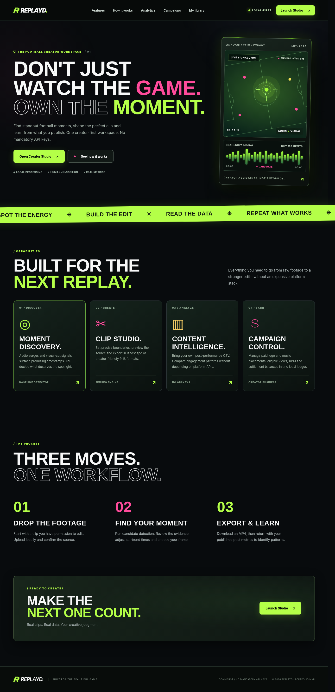
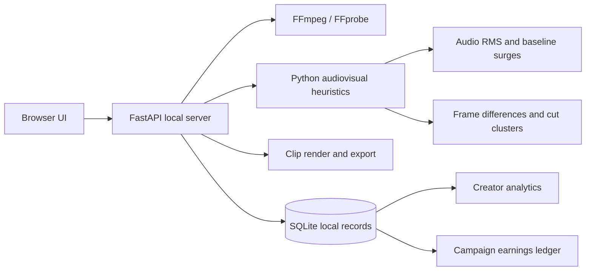

# REPLAYD — Football Creator Studio

**Local-first football highlight candidate detection, editable video clipping, creator analytics and paid campaign tracking.**

REPLAYD helps an editor find promising moments, review the suggested timestamps, export clips, compare their own published content and track campaign earnings. The user decides what to publish: **REPLAYD is an assistant, not an automated referee.**

> **Portfolio release v1.0.** This repository freezes the tested v0.6 product interface and adds reproducible evaluation, developer documentation and CI. It does **not** claim trained goal recognition, verified accuracy on external football datasets or increased engagement.


## 🎬 Watch REPLAYD in Action

[▶ Watch the 92-second REPLAYD Demo](https://github.com/user-attachments/assets/3e7ff4d2-4bef-4f0a-b246-ee7e72c84271)

[View v1.0 Release](https://github.com/dbee-git/REPLAYD/releases/tag/v1.0.0)
  


**Application previews:** [Studio with synthetic signal](docs/screenshots/studio-synthetic.png) · [Analytics with fictional data](docs/screenshots/analytics.png) · [Campaign Hub](docs/screenshots/campaigns.png)

## What works

| Area | Capability |
|---|---|
| Studio | Import MP4/MOV/MKV/WebM, analyze audio activity and independently proposed scene-change moments, inspect candidate timestamps |
| Editor | Adjust clip start/end as `MM:SS` or `MM:SS.xx`; choose original, 9:16 contained or 9:16 center crop; export MP4 |
| Analytics | Import CSV/TSV, paste rows, or add posts manually; tolerate missing fields; compare saves/shares per 1,000 views, categories, lengths and platforms |
| Campaigns | Track logo/music briefs, preferred lengths, RPM in USD per 1M eligible views, submitted clips, approvals, payout caps and partial settlements |
| Library | Review local source projects and previously rendered clips |
| Tests | Automated unit/API/media tests plus a separate real-video evaluation workflow |

**Current boundary:** Video upload is capped at 350 MB / 20 minutes. The detector is a rules-based audiovisual *candidate ranker*, not a deep-learning football event classifier. The app is single-user local software, not secured for public multi-user hosting.

## Quick start

Requirements: Python 3.10+ recommended, FFmpeg/FFprobe installed and on `PATH`.

```bash
# macOS: brew install ffmpeg
# Ubuntu/Debian: sudo apt-get install ffmpeg
python3 -m venv .venv
source .venv/bin/activate  # Windows PowerShell: .venv\Scripts\Activate.ps1
python -m pip install -r requirements.txt
python run.py
```

Open **http://127.0.0.1:8000**. The server binds to loopback only. No paid AI API key is necessary; the optional Google Fonts stylesheet may use a network connection.

### First-use walkthrough

1. Select **Launch Studio**, then **Use the synthetic test video instead**.
2. Choose **Edited highlights**, sensitivity `0.20` and up to `10` suggestions. Click **Analyze moments**.
3. Select a candidate and adjust its `MM:SS` clip boundaries if needed.
4. Export a short MP4 using **9:16 — full frame + padding** to preserve the whole pitch.
5. Open **Analytics → Try demo insights** to load explicitly synthetic posts.
6. Open **Campaigns** to explore the local, creator-entered payment ledger.

Synthetic test clips demonstrate the pipeline, not the model's ability to recognize real goals. Do not use third-party broadcasts without permission or upload private data to a public repository.

## Architecture at a glance



The processing pipeline uses NumPy, pandas, FFmpeg and Python; the interface is plain HTML, CSS and JavaScript. No hosted model service, paid social API or trained football event model is required. See [system architecture](docs/ARCHITECTURE.md) and [design limitations](docs/LIMITATIONS.md).

## Reproducible testing

```bash
python -m pytest -q
```

At portfolio packaging, **75 automated tests passed locally**. A GitHub Actions workflow also runs the tests on supported Linux/Python environments. A passing test suite verifies software behavior, **not** football-event detection accuracy.

### Real-football detection benchmark — results pending

**Do not insert made-up metrics.** The benchmark must be measured on human-labeled footage that the project has not been tuned on.

| Metric | Result |
|---|---|
| Precision @ ±5 s | Pending labeled-footage evaluation |
| Recall @ ±5 s | Pending labeled-footage evaluation |
| F1 @ ±5 s | Pending labeled-footage evaluation |
| Goal coverage @ ±5 s | Pending labeled-footage evaluation |
| Audio-only vs audiovisual | Pending labeled-footage evaluation |
| Editing time saved | Pending stopwatch comparison |

See [evaluation protocol](docs/EVALUATION.md) and `scripts/evaluate_portfolio.py`. The benchmark reports candidate spotting, **not semantic goal classification**. It compares audio-only against the current audiovisual heuristic using the same candidate budget.

## Project organization

```text
replayd/               Backend: video processing, detection, analytics, campaigns
static/                Existing browser interface (design frozen)
scripts/               Goal-coverage and portfolio evaluation CLIs
tests/                 Automated software regression tests
evaluation/            Label templates and reporting protocol
data/                  Clearly simulated CSV and short synthetic test videos
docs/                  Architecture, demo script, limitations, release history
.github/workflows/     CI tests
```

`run.py` starts a local Uvicorn server. Runtime uploads, exported videos, creator earnings, payment records and SQLite databases live in `.local_data/` or a path supplied via `REPLAYD_DATA_DIR` and are ignored by Git.

## Demonstration

Run `python scripts/demo_end_to_end.py` for an authentic synthetic-video analysis/export test. See [60–90 second demo storyboard](docs/DEMO.md) and [resume/interview notes](docs/RESUME_AND_INTERVIEW.md). Use only synthetic footage and simulated metrics for a publicly distributed demo. Record real-footage tests privately unless permission covers redistribution.

## Data, privacy and limitations

- Private records are stored locally and are not committed with the application.
- Campaign amounts depend on **approved eligible views**, RPM and caps; public views are not necessarily billable.
- Analytics are descriptive. They do not establish causality or guarantee reach/earnings.
- External opportunity/Discord links are informational; REPLAYD does not endorse or verify live campaign availability.
- The app is not production-hardened for internet exposure (no user auth or resource/job queue).
- Third-party footage, music and platform trademarks remain their respective owners' property.

## License

Source code: [MIT License](LICENSE). Synthetic examples are demonstration data. External names, platform logos and any footage you import are not re-licensed by this repository. The included Google Fonts are served from Google's CDN under their respective licenses.

## Publishing

Use the [GitHub publishing checklist](docs/GITHUB_PUBLISHING.md) to push this source release without private footage or local creator records.
